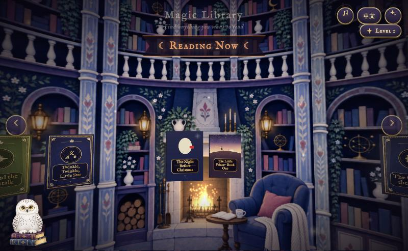
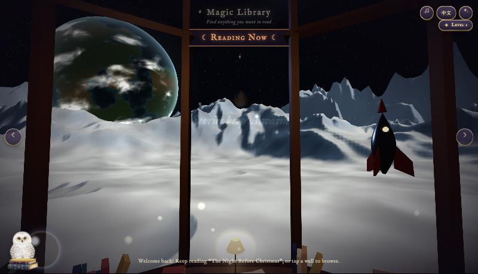
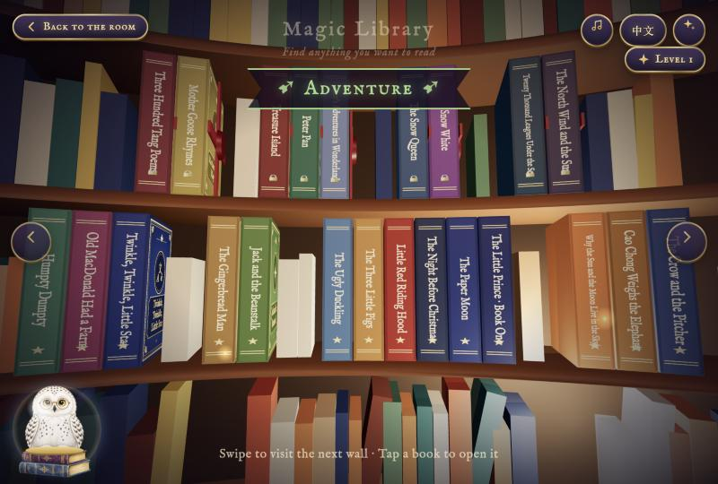
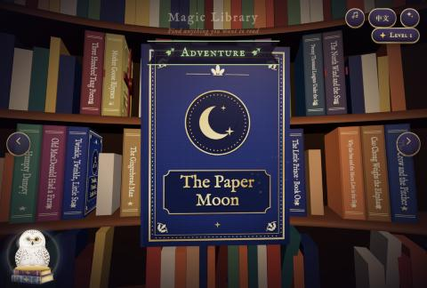
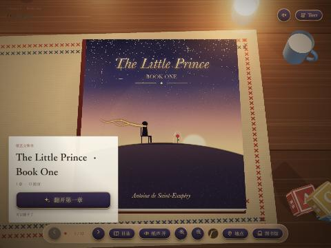
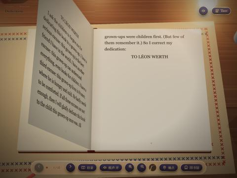

# 魔法图书馆 · Magic Library

一座可以走进去的 3D 图书馆。孩子在里面挑书，翻开就是会动、会朗读、能互动的"魔法书"。

**在线体验：** https://lixiangworkandstudy-bot.github.io/magic-library/
（电脑和 iPad 的浏览器都能打开；第一次加载需要几秒）

| 烛光书房 | 月球图书馆 |
|---|---|
|  |  |

---

## 为什么做它

儿童电子书大多是"会翻页的 PDF"，或者是互动太多、打断阅读的小游戏。这个项目想找第三条路：

- **魔法服务于文字。** 原文是主角，特效只放在文字本身就有画面的地方。《小王子》保留完整的英文原文，只在"蟒蛇吞大象""给我画一只羊"这样的段落里让插图动起来。
- **形式由书决定。** 立体书、会动的插图书、翻翻书，不套用同一个模板。
- **奖励"怎么读"，而不是"读多少"。** 读书换来的是图书馆皮肤，皮肤和读过的书绑定，不能花钱买，避免外在奖励挤掉阅读本身的乐趣（过度理由效应，Lepper 1973）。

## 体验流程

1. **走进图书馆**：拖动环顾四周，魔法棒（手指或鼠标）照到哪里，哪里的书就醒过来。每本书有自己的性格：害羞的会躲开，瞌睡的会打哈欠。墙上还藏着只有魔法棒才照得出的句子。
2. **找书、取书**：在月球图书馆里，书插在弧形书柜里，书脊印着书名和等级星星。碰一下，书抽出一截并读出书名；点一下，书被取下来，转成封面朝前，飞到面前翻开。
3. **读书**：文字浮在书页上方，读到哪个词，哪个词就放大变色，跟着朗读走。点任意一个词能单独听它的读音。

| 书柜：书脊上的书名 | 取下一本书 |
|---|---|
|  |  |

## 书架上的书

| 书 | 形式 | 状态 |
|---|---|---|
| 《纸月亮》 | 原创剪纸立体书：分层纸片、可转动视角 | 可读 |
| 《小王子》第一册 | 会动的插图书：法文原著自译英文全文，插图随段落动起来 | 可读（第 1–3 章） |
| 《圣诞前夜》 | 改编自 *The Night Before Christmas*（公版），翻翻纸机关 | 灰盒样书 |
| 其他 20 本 | 童话、科学、冒险、儿歌等书目 | 占位，书架上可见 |

| 《小王子》封面 | 《小王子》内页 |
|---|---|
|  |  |

## 两套图书馆

- **烛光书房**（默认）：环形书墙、壁炉、漂浮的书，背景音乐由代码实时合成（音乐盒五声音阶）。
- **月球图书馆**（读完《纸月亮》解锁）：主角是窗外的风景。12 面木框落地窗外，是程序生成的雪白尖山和巨大的地球，风格参考 60 年代太空海报和观景台建筑。室内偏暗偏暖，用来衬托窗外；书不挡风景，全部收进身后的弧形书柜。

## 面向儿童的设计细节

- **字体**：英文用 Andika（SIL 专为初学阅读设计，单层 a / g），中文用接近语文课本字形的楷体（霞鹜文楷）。
- **逐词高亮**：只高亮正在读的那个词，帮孩子建立"声音和文字"的对应。
- **自适应版面**：书和文字始终保持合适的比例，横屏、竖屏、iPad 都能用。
- **手指就够了**：所有操作都是点和拖，不需要键盘。
- **分级**：每本书有等级；当前等级读完 3 本就升一级，封印的书从高处飞下来。

## 技术实现

- **纯前端、零构建**：原生 ES 模块 + [three.js](https://threejs.org/)（r180，已放在 `vendor/`）。没有框架，也没有打包步骤，改完刷新就能看到。
- **3D 场景全部用代码生成**：月面地形用山脊噪声（ridged noise）生成，配合自定义着色器做出海报式明暗；地球的大陆和云用 3D 噪声绘制；书柜里几百本装饰书用 InstancedMesh 一次绘制。
- **数据驱动**：书单、书区、提示语、升级规则在 `data/library.json`；每本书的内容在 `data/books/<id>.json`，新增一本书不用改代码。
- **配音**：用 edge-tts 生成，附带逐词时间轴，用来做跟读高亮（`tools/make_voice.py`）。
- **单文件打包**：`tools/build_standalone.py` 把整个图书馆（脚本、数据、图片、配音）打成一个约 18 MB 的 HTML 文件，双击就能离线打开。

## 本地运行

```bash
python3 tools/serve.py          # 打开 http://127.0.0.1:5103/
python3 tools/serve.py --lan    # 同一 Wi-Fi 的 iPad / 手机也能访问
```

打包成单个 HTML：

```bash
python3 tools/build_standalone.py    # 输出 dist/magic-library.html
```

## 项目结构

```
index.html / book.html   图书馆 / 阅读器
js/                      library.js（图书馆）、skins.js（月球皮肤）、app.js（阅读器）、pagebook.js（插图书引擎）……
data/                    书单与每本书的内容
assets/                  插图、封面、墙面、配音
stories/                 故事脚本、《小王子》原文与译稿、插图提示词
tools/                   开发服务器、配音生成、打包脚本
docs/DEVELOPMENT.md      开发笔记：改什么去哪里改
```

## 版权说明

- 《小王子》法文原著（1943）在中国已进入公有领域；在美国要到 2039 年才进入公有领域，书名和角色形象在多国受商标保护。本项目的英文是自己从法文翻译的，插图是原创设计，不临摹 1943 年原版插图。本项目仅作学习和作品展示。
- 配音由 edge-tts 合成，仅用于非商业演示，不可商用。
- three.js 使用 MIT 许可；字体 Andika、Libre Baskerville、IM Fell English、霞鹜文楷均为 OFL 开源字体。
